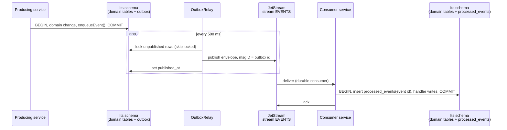

# Events and the outbox

Services change each other's state only through events. This guide covers the contracts that define events, how a service publishes them safely with a transactional outbox, how they travel on NATS JetStream, and how a consumer handles them exactly once in effect.

All the code lives in two libraries: `@life-island/contracts` (`libs/contracts`) and `@life-island/be-common` (`libs/be-common`).

## The big picture



The guarantees come from three pieces working together:

| Problem                                                                                   | Solved by                                                                                  |
| ----------------------------------------------------------------------------------------- | ------------------------------------------------------------------------------------------ |
| A change is saved but its event is lost (or the event goes out but the change rolls back) | The **outbox**: the event row is written in the same transaction as the change             |
| The relay publishes, then crashes before recording it, and publishes again                | JetStream **message dedupe**: the outbox id is the message id                              |
| NATS redelivers a message the consumer already handled                                    | The **`processed_events`** table, written in the same transaction as the handler's changes |

The result is _at-least-once delivery_ with an _exactly-once effect_.

## Contracts

Every event type has a **versioned contract name**: `<domain>.<name>@<version>`, all lowercase, with a version of 1 or more. Examples: `grocery.receipt@1`, `record.approved@1`, `catalog.target.registered@1`.

```ts
import { parseContractName, subjectFor } from '@life-island/contracts';

parseContractName('grocery.receipt@1'); // { type: 'grocery.receipt', version: 1 }
subjectFor('record.approved@2'); // 'events.record.approved.v2'
parseContractName('grocery.receipt'); // throws: version missing
```

A breaking change to a payload means a new version (`@2`), published alongside the old one until every consumer has moved. Additive, optional fields can stay on the same version.

### The envelope

Every message on NATS is a JSON **envelope**, validated by `eventEnvelopeSchema`:

```json
{
  "id": "0b9c5f8e-5d43-4c1a-9a51-3e2f4f9e7a10",
  "type": "record.approved@1",
  "source": "review",
  "occurredAt": "2026-10-23T20:00:00.000Z",
  "payload": { "stagingId": "…" }
}
```

| Field        | Meaning                                                                                                                                   |
| ------------ | ----------------------------------------------------------------------------------------------------------------------------------------- |
| `id`         | The outbox row's UUID. Also the JetStream message id and the consumer's idempotency key                                                   |
| `type`       | Versioned contract name                                                                                                                   |
| `source`     | The producing service (defaults to its schema name)                                                                                       |
| `occurredAt` | When the outbox row was written, ISO 8601                                                                                                 |
| `payload`    | The event body. Today it is typed as `unknown`; each event will get its own Zod payload schema in `libs/contracts` as the services arrive |

## Publishing: the transactional outbox

Write the domain change and the event **in the same transaction**, using the same client:

```ts
import {
  createServiceDb,
  enqueueEvent,
  withTransaction,
} from '@life-island/be-common';

const { pool } = createServiceDb({
  connectionString: process.env.REVIEW_DATABASE_URL!,
  schema: 'review',
});

await withTransaction(pool, async (client) => {
  await client.query(`update staging set status = 'APPROVED' where id = $1`, [
    stagingId,
  ]);
  await enqueueEvent(client, 'review', {
    type: 'record.approved@1',
    payload: { stagingId, targetKey, data },
  });
});
```

`enqueueEvent` validates the contract name, inserts a row into `<schema>.outbox` and returns its id. Nothing is sent to NATS yet. If the transaction rolls back, the event disappears with the change. Never publish to NATS directly from request code.

## The relay

`OutboxRelay` moves committed outbox rows to NATS. Each service runs one alongside its app:

```ts
import {
  connectNats,
  ensureEventsStream,
  OutboxRelay,
} from '@life-island/be-common';

const nats = await connectNats(process.env.NATS_URL!, 'svc-review');
await ensureEventsStream(nats);

const relay = new OutboxRelay({
  pool,
  nats,
  schema: 'review',
  onError: (error) => logger.error(error),
});
relay.start();

// on shutdown
await relay.stop();
await nats.drain();
```

What one cycle does, in a single transaction:

1. `select … from <schema>.outbox where published_at is null order by created_at limit <batchSize> for update skip locked`
2. For each row, build the envelope and publish it to `subjectFor(event_type)` with `msgID` set to the row id, waiting for JetStream's acknowledgement.
3. `update … set published_at = now()` for the published rows, then commit.

| Option           | Default         | Meaning                                                               |
| ---------------- | --------------- | --------------------------------------------------------------------- |
| `batchSize`      | `100`           | Rows per transaction. A full batch is followed immediately by another |
| `pollIntervalMs` | `500`           | Pause after the outbox is drained                                     |
| `source`         | the schema name | Value of the envelope's `source`                                      |
| `onError`        | none            | Called when a cycle fails; the next cycle retries                     |

Properties worth knowing:

- **Order** is by `created_at` within one service's outbox. There is no global order across services.
- **Several relays can run at once.** `skip locked` gives each one different rows.
- **A crash between publish and commit** leaves rows unpublished, so they are sent again. JetStream drops a repeated `msgID` within the stream's 2-minute duplicate window. After that window, the consumer's `processed_events` still catches the duplicate.
- `relay.publishBatch()` runs one cycle and returns how many rows it published; tests use it to step the relay by hand.

## The `EVENTS` stream

`ensureEventsStream(nats)` creates the stream if it does not exist:

| Setting          | Value      | Why                                                                      |
| ---------------- | ---------- | ------------------------------------------------------------------------ |
| Name             | `EVENTS`   | One stream for all domain events                                         |
| Subjects         | `events.>` | Every subject produced by `subjectFor`                                   |
| Retention        | Limits     | Messages stay until limits are hit, so a new consumer can replay history |
| Storage          | File       | Survives NATS restarts (kept in the `nats-data` volume)                  |
| Duplicate window | 2 minutes  | Dedupe for republished outbox rows                                       |

Subjects follow `events.<domain>.<name>.v<version>`, e.g. `events.grocery.receipt.v1`, so a consumer can filter by exact type, by domain (`events.grocery.>`), or take everything.

## Consuming events idempotently

`startEventConsumer` creates (or reuses) a **durable** JetStream consumer, receives the chosen event types, and runs your handler at most once per event id:

```ts
import { startEventConsumer } from '@life-island/be-common';

const messages = await startEventConsumer({
  pool,
  nats,
  schema: 'grocery',
  durableName: 'grocery-record-approved',
  eventTypes: ['record.approved@1'],
  handle: async (event, client) => {
    // Payloads are `unknown` until each event has its own Zod schema in libs/contracts
    const { stagingId, data } = event.payload as {
      stagingId: string;
      data: unknown;
    };
    // `client` is inside the same transaction as the processed_events insert
    await client.query(
      'insert into receipts (source_staging_id, data) values ($1, $2)',
      [stagingId, data],
    );
    await enqueueEvent(client, 'grocery', {
      type: 'record.loaded@1',
      payload: { stagingId },
    });
  },
  onError: (error, subject) => logger.error({ error, subject }),
});

// on shutdown
await messages.close();
```

For each message:

1. Parse and validate the envelope. An invalid one counts as an error.
2. In one transaction: `insert into processed_events (event_id) … on conflict do nothing`. If the row already existed, the event was handled before, so skip the handler and commit. Otherwise run the handler with the same client and commit.
3. On success, `ack`. On any error, call `onError` and `nak`, so JetStream redelivers it.

Rules for handlers:

- **Do every write through the `client` you are given.** Writes through another connection are not covered by the transaction and break the guarantee.
- **Reply events go through `enqueueEvent` on the same client**, as in the example above.
- **Keep a unique business key** too (such as `source_staging_id`), as a second safety net.
- **Pick a stable `durableName` per service and purpose.** It is how JetStream remembers what this consumer has acknowledged; renaming it starts a new consumer from the beginning of the stream.

`processOnce(pool, schema, eventId, handler)` exposes step 2 on its own, for code that receives events another way.

## Current limits

- **No dead-letter handling yet.** A message whose handler always fails is redelivered forever. A maximum delivery count and a dead-letter path are planned with the first real consumer.
- **Payloads are not validated per type yet.** Only the envelope is validated; payload schemas are added in `libs/contracts` together with each event.
- **No tracing yet.** OpenTelemetry context in the envelope is on the hardening list.

## Testing

`libs/be-common/src/lib/outbox.int.spec.ts` exercises the whole path against real Postgres and NATS: rollback removes the outbox row, three events are published once and applied once, a repeated event id does not run the handler, and a republished row is dropped by JetStream. See [Testing and CI](testing-and-ci.md) for how to run it.
