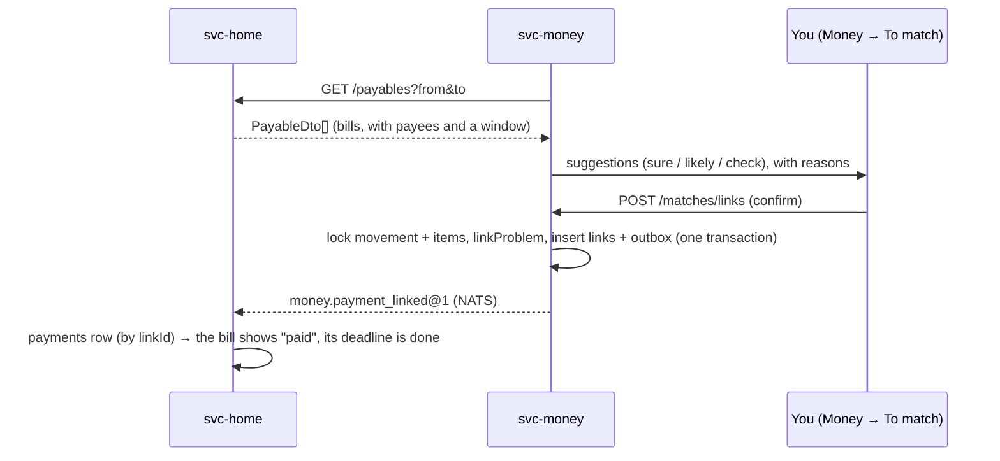

# Money matching

A bank movement already says who was paid, how much and when. Money matching
pairs each movement of your accounts with the item of another area it paid (a
bill in Houses today; the 730's expenses, subscriptions and car costs next), so
you confirm a payment once and every area knows it. Nothing is typed twice and
no payment proof is uploaded by hand for a bill.

The design rests on four rules, in this order:

1. **You confirm, except for sure direct debits.** Money ranks and explains.
   It links on its own only a **sure** match of an item paid automatically
   (`autoPay`: a direct debit, a card on file). That link is marked
   _Automatic_ and can be undone; undoing it says "not this one", so it is
   never made again. No AI is involved: the rules are plain code, tested line
   by line.
2. **Areas own their data.** An area publishes what it expects to pay
   (`GET /payables`) and learns of your confirmations from events. Money never
   writes in another area, and an area never trusts another area's keys.
3. **Every link is checked against both amounts, under lock.** A movement is
   never linked for more than it moved, an item never for more than it costs,
   even with two confirmations at the same time.
4. **Everything can be undone,** and an undo reaches the area the same way.

## What an area publishes: `GET /payables`

`libs/contracts/src/lib/payables.ts` has the shapes. Each `PayableDto` is:

| Field                 | Meaning                                                                                                |
| --------------------- | ------------------------------------------------------------------------------------------------------ |
| `key`                 | `<module>:<kind>:<id>`, stable: `home:bill:<uploadId>`. Money stores links by it                       |
| `title`, `path`       | How Money shows it, and where it is handled                                                            |
| `payees`              | The names a bank may print: supplier, provider and their aliases from Companies                        |
| `amount`, `direction` | Positive euros; `out` for money leaving your accounts                                                  |
| `date`, `window`      | When it should be paid, and the first and last day a movement can be its payment (both included)       |
| `tolerance`           | 0 for an invoice (to the cent); 0.1 for a subscription, so a price rise is still caught, as "check it" |

`?from&to` are the days of the movements Money is matching: list every item
whose window touches them, **open or already paid**, so Money can check the
links it made. Money keeps only the area's own, well-formed items
(`isOwnPayable`): an item whose key names another module is dropped.

To add an area: publish the route, add its module to `PAYABLE_MODULES`, give
Money its URL in `PAYABLE_SOURCES` (`home=http://svc-home:3000,…`, the local
ports when unset), add a `payments` table and the shared consumer (below).

## How Money proposes (`suggestMatches`)

A movement and an item can pair only when **all** of these hold: the same
direction, the movement's day inside the item's window, and the amount equal to
the cent (or within the item's tolerance). Then:

- **Sure**: exact amount, the bank names the payee (`payeeFit` agrees), and the
  pair is unique on both sides (no other movement fits the item, no other item
  fits the movement).
- **Likely**: exact and unique, but the bank prints only codes (an SDD with a
  creditor id) or names it partly.
- **Check it**: a price that changed, two items of the same amount, two
  movements for one item, or one transfer that paid 2 or 3 items of the same
  payee together.
- **Never**: the bank names someone else (A2A for an Enel bill), or you said
  "not this one" (`match_rejections`), or the item is already fully linked.

Names are compared after dropping the bank's words (ADDEBITO, SDD, BONIFICO,
POS…), any word with a digit, legal forms and generic words (a pharmacy is not
_the_ pharmacy). Each suggestion carries its reasons in plain words.

## How Money links (`MatchingService.link`)

1. Read the item from its area for the movement's day (outside any
   transaction). An area that does not answer: 503, nothing is linked.
2. In one transaction: lock the movement (`for update`) and each item
   (`pg_advisory_xact_lock`, in key order); refuse if the movement changed
   meanwhile, if directions differ, or if `linkProblem` finds that the links of
   the movement or of the item would exceed its amount.
3. Insert the links with a snapshot of the item's title and page, and one
   `money.payment_linked@1` per link into the outbox. Commit.

**Automatic links.** `GET /matches` (and the attention badge, which reads it)
first links every suggestion that is `sure`, of one item, with `autoPay`, through
the same `link` (locks and checks included), with `auto = true`. Two requests at
once cannot link it twice: the second gets a conflict and moves on. A likely or
"check it" match of a direct debit is still asked, so a debit the bank prints
only as codes never pays the wrong bill.

Removing a movement or an account, and undoing a link, delete the links and
enqueue `money.payment_unlinked@1` in the same transaction. A movement's amount
can change only while it keeps its direction and stays at or above what is
linked. The `movement_links` foreign key is `restrict`, so nothing removes a
linked movement behind these routes.

The "To match" tab also shows each link's status: `gone` when the area no
longer lists the item, `changed` when it now costs less than what is linked,
`unknown` when the area did not answer.

## What the area does: `paymentEventHandler`

`libs/be-common/src/lib/payments.ts` applies both events to the area's own
`payments` table (one row per `linkId`). An undone link keeps its row with
`unlinked_at`, so redelivery or the two events arriving out of order never
bring a payment back. The area then reads its payments by key: Houses shows
`bankPayment` on each bill, marks its deadline done when paid in full, and stops
counting it as due.

## Per area

| Area   | Items                                                                                                              | What a link does                                                                                                |
| ------ | ------------------------------------------------------------------------------------------------------------------ | --------------------------------------------------------------------------------------------------------------- |
| Houses | Each counted bill with a due (or issue) date and something to pay; window from 3 days before issue to 45 after due | `bankPayment` on the bill; its Agenda date is done; no "due soon" badge                                         |
| 730    | (next) deductible expenses                                                                                         | The payment is traceable, from the movement. The receipt is still asked for: the document is the proof you keep |

## Tests

- `libs/contracts/src/lib/payables.spec.ts`: the rules, with real Italian bank
  descriptions.
- `apps/svc-money/src/app/matching.int.spec.ts`: two confirmations of one bill
  at the same time (one wins), partial payments, limits, an area down, undo,
  removing movements and accounts, "not this one".
- `apps/svc-home/src/app/home.int.spec.ts`: the bill payables, and the events
  applied once and in any order.
