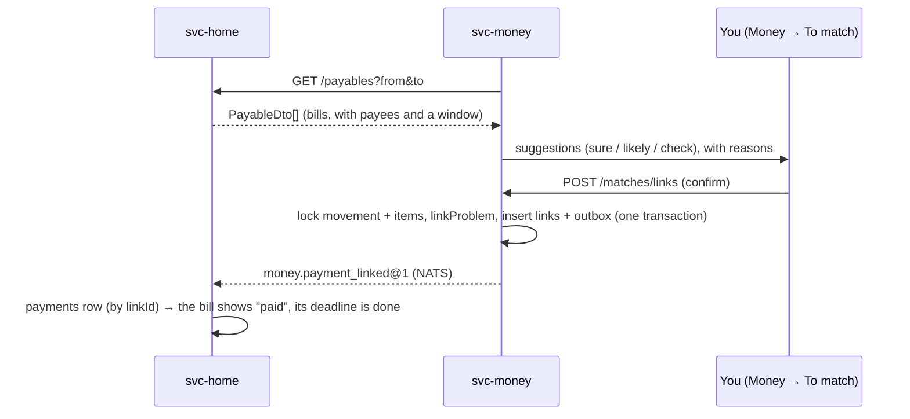

# Money matching

A bank movement already says who was paid, how much and when. Money matching
pairs each movement of your accounts with the item of another area it paid (a
bill in Houses, a car cost or fine, a subscription's charge, a payslip's pay,
a grocery receipt, an expense of the 730), so
you confirm a payment once and every area knows it. Nothing is typed twice and
no payment proof is uploaded by hand for a bill.

The design rests on four rules, in this order:

1. **You confirm, except for sure direct debits.** Money ranks and explains.
   It links on its own only a **sure** match of an item paid automatically
   (`autoPay`: a direct debit, a card on file). That link is marked
   _Automatic_ and can be undone; undoing it says "not this one", so it is
   never made again. No AI is involved: the rules are plain code, tested line
   by line.
2. **Areas own their data.** An area publishes what it expects to pay
   (`GET /payables`) and learns of your confirmations from events. Money never
   writes in another area, and an area never trusts another area's keys.
3. **Every link is checked against both amounts, under lock.** A movement is
   never linked for more than it moved, an item never for more than it costs,
   even with two confirmations at the same time.
4. **Everything can be undone,** and an undo reaches the area the same way.

## What an area publishes: `GET /payables`

`libs/contracts/src/lib/payables.ts` has the shapes. Each `PayableDto` is:

| Field                 | Meaning                                                                                                |
| --------------------- | ------------------------------------------------------------------------------------------------------ |
| `key`                 | `<module>:<kind>:<id>`, stable: `home:bill:<uploadId>`. Money stores links by it                       |
| `title`, `path`       | How Money shows it, and where it is handled                                                            |
| `payees`              | The names a bank may print: supplier, provider and their aliases from Companies                        |
| `amount`, `direction` | Positive euros; `out` for money leaving your accounts                                                  |
| `date`, `window`      | When it should be paid, and the first and last day a movement can be its payment (both included)       |
| `tolerance`           | 0 for an invoice (to the cent); 0.1 for a subscription, so a price rise is still caught, as "check it" |
| `paidInCash`          | A receipt paid in cash: never paired with a bank movement; Money offers to add it to an account        |
| `lines`               | What was bought (name, amount, Money category): fills the note and parts of the movement linked to it  |

`?from&to` are the days of the movements Money is matching: list every item
whose window touches them, **open or already paid**, so Money can check the
links it made. Money keeps only the area's own, well-formed items
(`isOwnPayable`): an item whose key names another module is dropped.

To add an area: publish the route, add its module to `PAYABLE_MODULES`, give
Money its URL in `PAYABLE_SOURCES` (`home=http://svc-home:3000,…`, the local
ports when unset), add a `payments` table and the shared consumer (below).

## How Money proposes (`suggestMatches`)

A movement and an item can pair only when **all** of these hold: the same
direction, the movement's day inside the item's window, and the amount equal to
the cent (or within the item's tolerance). Then:

- **Sure**: exact amount, the bank names the payee (`payeeFit` agrees), and the
  pair is unique on both sides (no other movement fits the item, no other item
  fits the movement).
- **Likely**: exact and unique, but the bank prints only codes (an SDD with a
  creditor id) or names it partly.
- **Check it**: a price that changed, two items of the same amount, two
  movements for one item, or one transfer that paid 2 or 3 items of the same
  payee together.
- **Never**: the bank names someone else (A2A for an Enel bill), or you said
  "not this one" (`match_rejections`), or the item is already fully linked.

A charge a little over its price (within the tolerance: a subscription whose
price went up) is proposed with the movement's whole amount, and the same when
you pick it by hand (`pickAmount`), so the area learns what was really charged.
It stays "check it", so it is never linked on its own.

Names are compared after dropping the bank's words (ADDEBITO, SDD, BONIFICO,
POS…), any word with a digit, legal forms and generic words (a pharmacy is not
_the_ pharmacy). Each suggestion carries its reasons in plain words.

## How Money links (`MatchingService.link`)

1. Read the item from its area for the movement's day (outside any
   transaction). An area that does not answer: 503, nothing is linked.
2. In one transaction: lock the movement (`for update`) and each item
   (`pg_advisory_xact_lock`, in key order); refuse if the movement changed
   meanwhile, if directions differ, or if `linkProblem` finds that the links of
   the movement or of the item would exceed its amount.
3. Insert the links with a snapshot of the item's title and page, and one
   `money.payment_linked@1` per link into the outbox. Commit.

**Automatic links.** `GET /matches` (and the attention badge, which reads it)
first links every suggestion that is `sure`, of one item, with `autoPay`, through
the same `link` (locks and checks included), with `auto = true`. Two requests at
once cannot link it twice: the second gets a conflict and moves on. A likely or
"check it" match of a direct debit is still asked, so a debit the bank prints
only as codes never pays the wrong bill.

Removing a movement or an account, and undoing a link, delete the links and
enqueue `money.payment_unlinked@1` in the same transaction. A movement's amount
can change only while it keeps its direction and stays at or above what is
linked. The `movement_links` foreign key is `restrict`, so nothing removes a
linked movement behind these routes.

On the Movements tab, each movement shows what it paid (`paidItems` of
`GET /overview`) as chips that open the item, and the movement's edit dialog
says that deleting it, or changing it so it no longer covers the item, undoes
the match.

The "To match" tab also shows each link's status: `gone` when the area no
longer lists the item, `changed` when it now costs less than what is linked,
`unknown` when the area did not answer.

## What a receipt adds (`lines`, `paidInCash`)

Receipts and orders are never uploaded in Money: they go through the documents
app like every file, the parse worker reads them as `grocery.receipt@1`
(a shop receipt, an Amazon order page or its screenshot), and Groceries loads
the ones you confirm. Its `GET /payables` lists each one with its `lines`,
each in a Money category (`ITEM_MONEY_CATEGORY`: pharmacy in Health, other
items in Shopping, the rest in Groceries).

- **By card:** paired with its movement like any item. When a link covers the
  whole movement and you never wrote its note or parts, `fillFromReceipt` sets
  them from the lines in the same transaction: the category becomes the one
  most of the lines are in (the receipt knows better than the bank's text),
  the note lists what was bought, most expensive first, and the parts group
  the other lines (`purchaseDetails`).
- **In cash** (`paidInCash`): no bank movement will show it, so
  `suggestMatches` leaves it out. The "To match" tab lists it under **Paid in
  cash**, and `POST /matches/cash` makes a movement of the account you pick
  (a cash one by default), in the category most of the lines are in, then
  links it through `link` (so the checks and the event are the same). If the
  link fails (another click added it first), the movement is removed. The
  Attention badge counts them too.

Banks print some shops by a short name (Amazon as `AMZN Mktp`):
`BANK_ALIASES` maps them before names are compared.

## What the area does: `paymentEventHandler`

Every area declares the table with `paymentsTable(schema)`
(`libs/be-common/src/lib/payments-table.ts`) and groups its rows with
`paymentsByKey` (libs/contracts).
`libs/be-common/src/lib/payments.ts` applies both events to the area's own
`payments` table (one row per `linkId`). An undone link keeps its row with
`unlinked_at`, so redelivery or the two events arriving out of order never
bring a payment back. The area then reads its payments by key: Houses shows
`bankPayment` on each bill, marks its deadline done when paid in full, and stops
counting it as due.

## Per area

| Area          | Items                                                                                                                                                                                                                                                                                                                                                                                                                                                                                                           | What a link does                                                                                                                                                                                                                                                  |
| ------------- | --------------------------------------------------------------------------------------------------------------------------------------------------------------------------------------------------------------------------------------------------------------------------------------------------------------------------------------------------------------------------------------------------------------------------------------------------------------------------------------------------------------- | ----------------------------------------------------------------------------------------------------------------------------------------------------------------------------------------------------------------------------------------------------------------- |
| Houses        | Each counted bill with a due (or issue) date and something to pay; window from 3 days before issue to 45 after due                                                                                                                                                                                                                                                                                                                                                                                              | `bankPayment` on the bill; its Agenda date is done; no "due soon" badge                                                                                                                                                                                           |
| Cars          | Each priced cost with a day (insurance, road tax, inspection, fuel, service, repairs…), window from 10 days before to 45 after, key `cars:cost:<upload id>`. Each fine with an amount, key `cars:fine:<upload id>`: proposed at its reduced amount with a tolerance up to the full one (paid within 5 days or within 60), from the violation to 60 days after the last day to pay (90 days of notice assumed until you add it). A late fine at half the maximum is over the tolerance: link what it can by hand | `bankPayment` on the cost. A fine paid at least its reduced amount is **paid** on that day (its deadlines and warning go); less is shown as a partial payment                                                                                                     |
| Subscriptions | Each charge of a contract, every billing cycle counted from its renewal day (or start): never before the start, during a free trial, after the end of one that does not renew, or after a cancellation. Priced at the cost of that day (price history); tolerance 0.1; `autoPay` as the contract; window from 5 days before to 10 after; key `subscriptions:charge:<id>.<day>`                                                                                                                                  | `lastCharge` on the contract. A charge over the price raises "charged more than its price" on Attention, with **Update the cost** in Contracts & subscriptions, until the cost is updated. Moving the renewal day renames the charges: their links show as `gone` |
| Work          | Each payslip with a month and a net pay, money **in** from the employer (its name and your label as payees); window from the 15th of the month paid to the 20th of the next; key `work:payslip:<upload id>`                                                                                                                                                                                                                                                                                                     | `bankPayment` on the payslip: "Received" with its day in the documents table                                                                                                                                                                                      |
| Groceries     | Each receipt or online order in euros (never meal vouchers), with its `lines`: by card (or not said), window from the day before to 5 days after the purchase; in cash, `paidInCash` and the day only. Key `groceries:receipt:<id>`                                                                                                                                                                                                                                                                             | `bankPayment` on the receipt: "Paid by card" on the latest receipts                                                                                                                                                                                               |
| 730           | Each counted expense (one paired into another is paid through that one); window from 30 days before its date to 90 after                                                                                                                                                                                                                                                                                                                                                                                        | `bankPayment` on the expense; it is **paid traceably** (also in the deduction estimate), shown as "Paid by bank". The payment proof document is still asked for: the CAF wants it                                                                                 |

## Tests

- `libs/contracts/src/lib/payables.spec.ts`: the rules, with real Italian bank
  descriptions.
- `apps/svc-money/src/app/matching.int.spec.ts`: two confirmations of one bill
  at the same time (one wins), partial payments, limits, an area down, undo,
  removing movements and accounts, "not this one".
- `apps/svc-money/src/app/receipts.int.spec.ts`: a card receipt fills its
  movement's note and parts (never over yours), a cash receipt is added to the
  cash account once, and only cash is added that way.
- `apps/svc-home/src/app/home.int.spec.ts`: the bill payables, and the events
  applied once and in any order.
- `apps/svc-cars/src/app/cars/payables.spec.ts`, `car-insights.spec.ts` and
  `cars.int.spec.ts`: costs and fines as payables, a fine paid reduced (sure)
  or full (check it), a fine paid from the bank, and an undo.
- `apps/svc-subscriptions/src/app/subscriptions/payables.spec.ts` and
  `subscriptions.int.spec.ts`: charge days and prices, a price rise matched as
  "check it" and linked whole, the last charge, its warning and its undo.
- `apps/svc-work/src/app/work/payables.spec.ts`, `work.int.spec.ts`,
  `apps/svc-groceries/src/app/receipts/payables.spec.ts` and
  `receipts.int.spec.ts`: pay coming in, card receipts (never cash), the
  payment shown and undone.
- `apps/svc-tax730/src/app/dossier/dossier.int.spec.ts`: the expense payables,
  a matched payment making an expense traceable while the receipt is still
  asked, and its undo.
