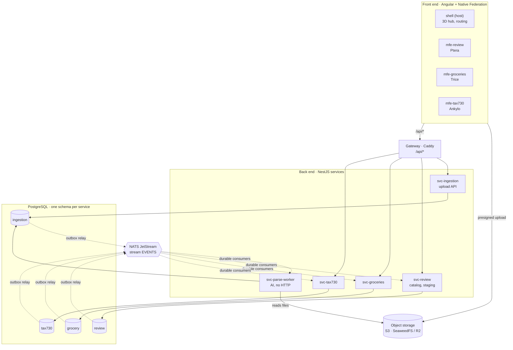
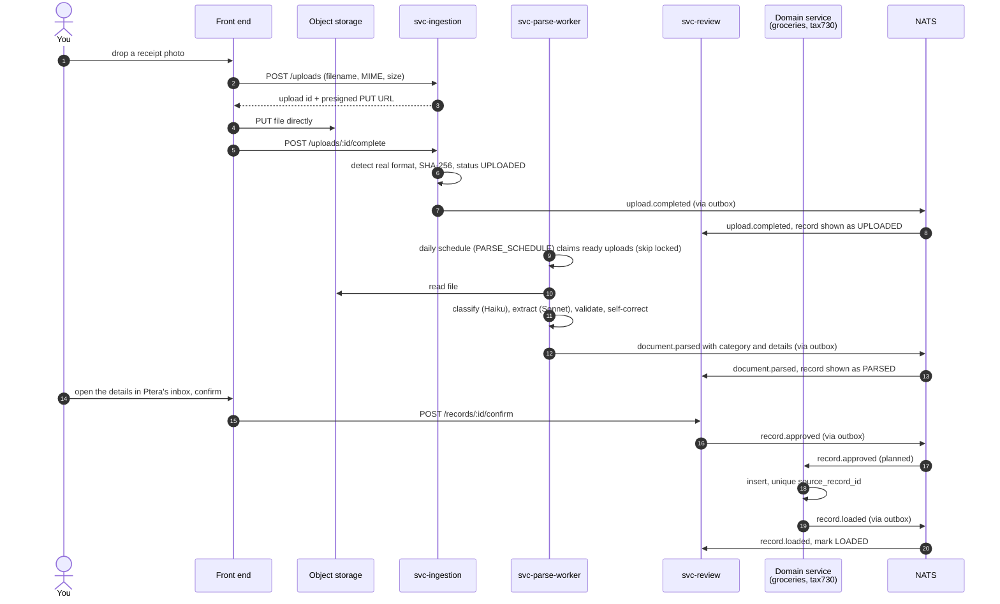

# System overview

Life Island is a personal life-management platform. You drop any document (a receipt photo, a PDF, a spreadsheet, an email) onto a 3D island. A background AI service works out what it is and where its data belongs, and puts the extracted records in a review inbox. Nothing reaches a module until you approve it there.

Each area of life is a **module** run by a **character**:

| Character             | Module         | What it does                                                    |
| --------------------- | -------------- | --------------------------------------------------------------- |
| Ptera (pterodactyl)   | Review inbox   | Lists AI-extracted records; you edit, approve or reject them    |
| Trice (triceratops)   | Groceries      | Receipts, items, merchants, spending by category, price history |
| Ankylo (ankylosaurus) | 730 tax return | Deductible expenses per tax year, totals, export for the CAF    |

Further modules (sport, travel, bills, car) follow the same recipe: the "New feature checklist" in [architecture.md](architecture.md#new-feature-checklist).

## The shape of the system



Three ideas hold the system together:

1. **Each service owns its data.** One Postgres schema per service, reached only through that service's own database role. No service can read another's tables. This is enforced by Postgres privileges, not by convention (see [Database](guides/database.md)).
2. **Services talk through HTTP for reads and events for changes.** Every state change leaves through a transactional outbox and travels on NATS JetStream. Consumers are idempotent, so a redelivered event never creates duplicates (see [Events and the outbox](guides/events-and-outbox.md)).
3. **Everything deploys on its own.** It is one Nx monorepo, but each app has its own build, Dockerfile, migrations and deployment. Lint rules stop apps from importing each other (see [Nx workspace](guides/nx-workspace.md)).

The complete list of non-negotiable principles is in [architecture.md](architecture.md#architecture-principles).

## How a document travels through the system



The parse worker shares the `ingestion` schema with the upload API: it is the same service split into an HTTP process and a background process. Two rules shape this flow: **files never pass through the API** (the browser uploads straight to storage with a presigned URL) and **the AI never writes domain data** (it writes staged records; a human approves; the domain service loads them). The detailed design of each step is in [architecture.md](architecture.md#ingestion-pipeline); what is built, how to run it and where it differs from the plan is in the [documents loader guide](guides/documents-loader.md).

## Technology choices

| Concern            | Choice                                                               | Why                                                                                         | Status                                         |
| ------------------ | -------------------------------------------------------------------- | ------------------------------------------------------------------------------------------- | ---------------------------------------------- |
| Monorepo           | Nx 24                                                                | Builds and tests only what changed; enforces module boundaries; Angular and Nest generators | In place                                       |
| Language           | TypeScript everywhere                                                | Shared contracts and types between front end and back end                                   | In place                                       |
| Database           | PostgreSQL 17 with pgvector                                          | One instance to run and back up, real per-service boundaries through schemas and roles      | In place                                       |
| Messaging          | NATS JetStream + transactional outbox                                | Lightweight, durable, built-in message dedupe                                               | In place                                       |
| Contracts          | Zod 4 in `libs/contracts`                                            | One source of truth for events, AI target schemas and DTOs                                  | In place                                       |
| File storage       | S3 API: SeaweedFS locally, Cloudflare R2 in production               | Files stay out of the database; presigned uploads                                           | In place (R2 by configuration)                 |
| Gateway            | Caddy 2                                                              | One origin for the front end, automatic HTTPS in production                                 | In place                                       |
| Tests              | Vitest                                                               | Fast, native ESM and TypeScript                                                             | In place                                       |
| CI                 | GitHub Actions + `nx affected`                                       | Only changed projects are checked                                                           | In place                                       |
| ORM and migrations | Drizzle ORM + drizzle-kit                                            | Close to SQL; one migrations folder per service                                             | In place                                       |
| Back end framework | NestJS 12                                                            | Structure, DI, OpenAPI                                                                      | In place (OpenAPI planned)                     |
| Front end          | Angular 22, zoneless, signals, Native Federation                     | Main learning goal; remotes deploy independently                                            | In place (standalone apps; federation planned) |
| AI                 | Claude API: Haiku to classify, Sonnet to extract, structured outputs | Cheap where possible, accurate where needed                                                 | In place (evals planned)                       |
| Observability      | OpenTelemetry + Langfuse                                             | One trace per upload; AI prompts, costs and evals                                           | Planned                                        |

## What exists today

Week 1 of the [roadmap](architecture.md#roadmap) is complete:

| Piece                                                                                                       | Where                                                            | Guide                                                                        |
| ----------------------------------------------------------------------------------------------------------- | ---------------------------------------------------------------- | ---------------------------------------------------------------------------- |
| Nx workspace with tag-based module boundaries                                                               | `nx.json`, `eslint.config.mjs`                                   | [Nx workspace](guides/nx-workspace.md)                                       |
| Local stack: Postgres, SeaweedFS, NATS, Caddy                                                               | `infra/docker-compose.yml`                                       | [Local infrastructure](guides/infrastructure.md)                             |
| Schemas `ingestion`, `review`, `grocery`, `tax730`, each with its own role, `outbox` and `processed_events` | `infra/postgres/init/`                                           | [Database](guides/database.md)                                               |
| Isolation check that fails if any role can reach another schema                                             | `infra/postgres/init/03-check-isolation.sql`                     | [Database](guides/database.md#the-isolation-check)                           |
| Event envelope and versioned contract names                                                                 | `libs/contracts`                                                 | [Events and the outbox](guides/events-and-outbox.md#contracts)               |
| Service DB factory, outbox writer, outbox relay, idempotent consumer                                        | `libs/be-common`                                                 | [Events and the outbox](guides/events-and-outbox.md)                         |
| CI: format, sync, styles, isolation check, `nx affected` lint/test/build/typecheck                          | `.github/workflows/ci.yml`                                       | [Testing and CI](guides/testing-and-ci.md)                                   |
| Documents loader: upload API, scheduled AI parse worker, review inbox with confirm                          | `apps/svc-ingestion`, `apps/svc-parse-worker`, `apps/svc-review` | [Documents loader](guides/documents-loader.md)                               |
| Upload and review front ends                                                                                | `apps/mfe-upload`, `apps/mfe-review`                             | [Documents loader](guides/documents-loader.md)                               |
| Angular design system: tokens, character themes, base components                                            | `libs/design-system`                                             | `libs/design-system/README.md`                                               |
| Target catalog: `grocery.receipt@1`, `tax730.expense@1`, `general.document@1`                               | `libs/contracts/src/lib/targets/`                                | [Documents loader](guides/documents-loader.md#categories-and-target-schemas) |

Not built yet: the shell with Native Federation and the 3D hub, the domain services that load confirmed records (`svc-groceries`, `svc-tax730`) and their front ends, editing details before confirming, and evals.

## Repository map

```
life-island/
├── apps/
│   ├── mfe-upload/  mfe-review/   #   Angular front ends (shell planned)
│   └── svc-ingestion/  svc-parse-worker/  svc-review/   # NestJS services
├── libs/
│   ├── contracts/                 # Zod contracts shared by every app
│   ├── be-common/                 # back-end building blocks (DB, migrations, outbox, NATS, S3)
│   ├── be-nest/                   # NestJS glue (validation, events runtime)
│   ├── ingestion-db/              # Drizzle schema of `ingestion`
│   └── design-system/             # Angular components and CSS tokens
├── infra/
│   ├── docker-compose.yml         # local stack
│   ├── postgres/init/             # schemas, roles, outbox tables, isolation check
│   ├── caddy/Caddyfile            # gateway routes
│   └── seaweedfs/s3.json          # local S3 credentials
├── docs/                          # this documentation
├── .github/workflows/ci.yml       # CI pipeline
├── .env.example                   # local settings template
├── nx.json  eslint.config.mjs     # workspace and lint configuration
└── tsconfig.base.json             # shared TypeScript settings
```

Later in the roadmap the plan adds `libs/fe-common` and `tools/evals/`; see [architecture.md](architecture.md#repository-layout).
